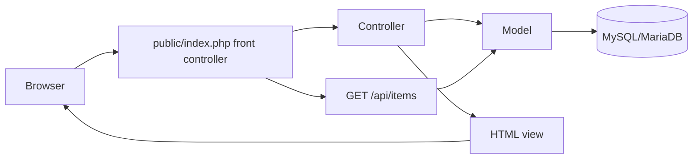

# Lost and Found

A PHP web application to report lost or found property and browse item reports by category. The active application now uses a small native-PHP MVC architecture; it does not depend on Laravel or another framework.

## Technology stack

- **PHP 8.1+** for request handling, sessions, validation, and server-rendered views.
- **MySQL/MariaDB** for users and item reports, accessed with PDO and prepared statements.
- **HTML, CSS, and vanilla JavaScript** for the responsive interface and client-side category filtering.
- **JSON over HTTP** for the read-only item-list endpoint.
- **Apache rewrite rules** or PHP's built-in development server to route requests through the front controller.
- **Vercel deployment:** the repository includes a community PHP runtime configuration. This runtime is not an official Vercel runtime.

There is no Composer dependency yet. Database configuration can be supplied through `DB_HOST`, `DB_NAME`, `DB_USER`, and `DB_PASSWORD`; local defaults are `127.0.0.1`, `lostnfound_db`, `root`, and an empty password.

## What users can do

- Browse the public homepage and select an item category.
- Register an account and sign in; passwords are stored as hashes.
- View their account profile and log out.
- Browse identification, electronics, and personal item reports; search by name and filter by location.
- Signed-in users can submit lost or found reports and optionally attach a validated image (JPG, PNG, GIF, or WebP up to 5 MB).

## MVC project structure

```text
app/
  Controllers/       Request handling, validation, and response selection
  Core/              Database connection and shared application services
  Models/            User and lost-item database access
  Views/             Server-rendered HTML templates
bootstrap.php        Autoloading, session setup, escaping, CSRF, and view helpers
public/
  index.php          Front controller and route table
  router.php         PHP built-in server static-file/router support
  .htaccess          Apache front-controller rewrite rules
  assets/            Public CSS
database/
  schema.sql         Database and table definitions
uploads/             User-uploaded item images (served through an allowlisted route)
api/index.php        Vercel Function entry point
vercel.json          Vercel PHP runtime and request routing
```

### Responsibilities

- **Models** (`app/Models`) contain database queries and persistence. They do not render HTML or read request globals.
- **Controllers** (`app/Controllers`) handle request data, call models, and choose a view or HTTP response.
- **Views** (`app/Views`) render presentation only. Dynamic output is escaped with the `e()` helper.
- **Core/bootstrap** provides PDO configuration, autoloading, sessions, CSRF validation, redirects, and view rendering.
- **Public front controller** (`public/index.php`) maps HTTP method/path pairs to controllers. The `public/` folder is the document root; application source and configuration stay outside it.

## Routes and API

| Method | Path | Purpose |
|---|---|---|
| `GET` | `/` | Public or signed-in homepage |
| `GET`, `POST` | `/login` | Show login form and authenticate |
| `GET`, `POST` | `/register` | Show registration form and create account |
| `POST` | `/logout` | End the session (CSRF protected) |
| `GET` | `/profile` | Signed-in user's profile |
| `GET` | `/items/identification` | Browse identification reports |
| `GET` | `/items/electronics` | Browse electronic-device reports |
| `GET` | `/items/personal` | Browse personal-item reports |
| `GET` | `/items/new?status=lost` or `?status=found` | Show the signed-in report form |
| `POST` | `/items` | Validate and save an item report |
| `GET` | `/api/items` | Return reports grouped by category as JSON |

`GET /api/items` is the application's read-only JSON API. It responds with the existing grouped shape:

```json
{
  "identification_cards": [],
  "electronic_devices": [],
  "personal_items": []
}
```

The legacy `display_items.php` URL and existing `.html`/`.php` page URLs are routed to their MVC equivalents where appropriate. This is a small web application API, not a complete REST API: there are no item update/delete endpoints, pagination, API authentication, or versioned API contract yet.

## Main request flow



## Local setup (Windows/XAMPP)

### 1. Start MySQL

Start **MySQL** in the XAMPP Control Panel. The default local credentials in `app/Core/Database.php` are host `127.0.0.1`, user `root`, and an empty password. Set environment variables before starting PHP if your database credentials differ.

### 2. Create the database

From the project directory, import the schema using XAMPP's MySQL client:

```powershell
Get-Content -Raw .\database\schema.sql | & 'C:\xampp\mysql\bin\mysql.exe' -u root
```

Use `-p` if MySQL requires a password, or import `database/schema.sql` through phpMyAdmin. The SQL creates `lostnfound_db`, `users`, and `lost_items`.

### 3. Start the PHP development server

The `public/` directory must be the web root:

```powershell
Set-Location 'C:\Users\gorti\OneDrive\Desktop\Projects\lost-and-found'
php -S 127.0.0.1:8000 -t public public/router.php
```

Visit [http://127.0.0.1:8000/](http://127.0.0.1:8000/). Stop the server with `Ctrl+C`. Do not use the project root as the web root for this MVC setup. The built-in server is for local development only.

## Deploy to Vercel

The repository is configured to run its PHP application through the community-maintained [`vercel-php`](https://github.com/vercel-community/php) runtime. Vercel currently lists PHP as a community custom runtime rather than an official runtime; the runtime maintainers recommend the Vercel container runtime for new PHP deployments. Review that support trade-off before using this setup for a production service.

1. Push this repository to GitHub and import it into Vercel. Use the repository root as the project root and leave the build/output directory unset.
2. Set these **Production** environment variables in the Vercel project settings to point to a remote MySQL/MariaDB database (do not use `localhost`):
   - `DB_HOST`
   - `DB_NAME`
   - `DB_USER`
   - `DB_PASSWORD`
3. Import `database/schema.sql` into that remote database using its provider's SQL console or a MySQL client. Do not expose database credentials in Git.
4. Deploy. The homepage is rendered without opening a database connection; account, category, report, and API routes require a reachable database.
5. Add durable shared session storage and object storage before relying on sign-in or image uploads in production. PHP's default file-backed sessions and this app's local upload directory are not durable/shared storage across serverless instances. New image uploads are therefore not a supported persistent Vercel feature yet.

The route config serves `/assets/*` from `public/assets` and sends other paths to `api/index.php`. Vercel's PHP runtime is community-maintained, so a successful local test is not a substitute for a Vercel deployment/build check in the connected project.

## Engineering conventions

The code follows modern practices supported by the PHP manual and common PHP project conventions:

- Declare strict types in application PHP files and use namespaces, type declarations, and small classes.
- Use PDO prepared statements for variable SQL values; do not concatenate user input into SQL.
- Keep secrets/configuration outside source-controlled code using environment variables.
- Validate input on the server, escape HTML at render time, and use CSRF tokens for state-changing forms.
- Hash passwords with `password_hash()` and verify them with `password_verify()`.
- Regenerate the session ID after authentication and use HTTP-only, same-site session cookies.
- Validate image content type and size on the server, generate storage names, and keep uploads outside the public document root.
- Log unexpected server exceptions and return a generic error instead of exposing database details to visitors.
- Use HTTP methods intentionally: GET for reads, POST for state changes, and redirects after successful form submissions.
- Keep formatting and namespaced class layout close to PSR-12 and PSR-4 conventions; the small project uses a local autoloader rather than requiring Composer.

Useful PHP manual references:

- [Type declarations and strict typing](https://www.php.net/manual/en/language.types.declarations.php)
- [PDO prepared statements](https://www.php.net/manual/en/pdo.prepared-statements.php)
- [Password hashing](https://www.php.net/manual/en/function.password-hash.php)
- [Session security](https://www.php.net/manual/en/session.security.php)
- [Handling file uploads](https://www.php.net/manual/en/features.file-upload.php)
